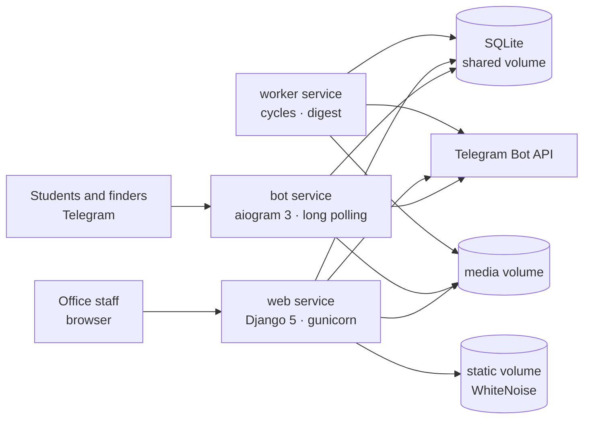
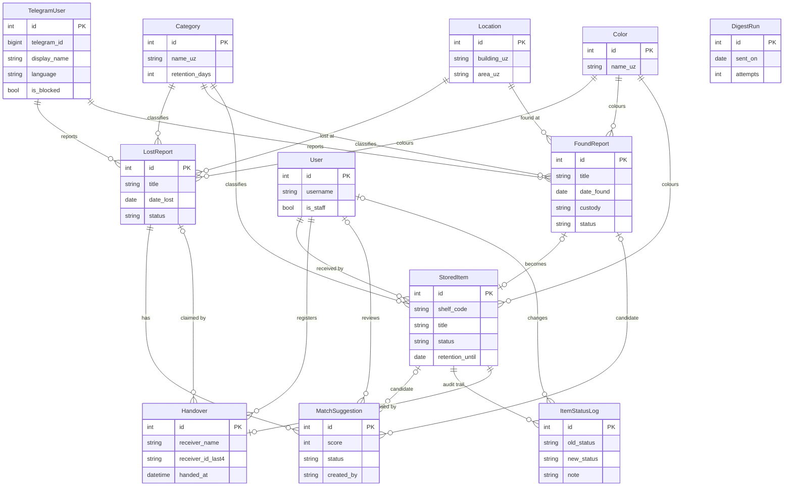

# Campus Lost & Found

A university lost-and-found platform built as a three-service Docker application:

- a **Telegram bot** where students report lost or found items and receive match notifications;
- a **Django office panel** where staff receive items into storage, review matches and hand items back;
- a **background worker** that keeps matching, retention checks, report expiry and the daily office digest running.

All three services share one SQLite database and one media volume, so a report created in Telegram is immediately visible to the office, and a handover performed in the office is immediately reflected in the bot.

---

## Contents

- [Live access](#live-access)
- [Features](#features)
- [Architecture](#architecture)
- [Technology stack](#technology-stack)
- [Quick start with Docker](#quick-start-with-docker)
- [Environment variables](#environment-variables)
- [Seed data](#seed-data)
- [Office web interface](#office-web-interface)
- [Telegram bot](#telegram-bot)
- [Matching engine](#matching-engine)
- [Background worker](#background-worker)
- [Daily office digest](#daily-office-digest)
- [CSV export](#csv-export)
- [Data model](#data-model)
- [Internationalization](#internationalization)
- [Tests](#tests)
- [Privacy and security](#privacy-and-security)
- [Deployment](#deployment)
- [Project structure](#project-structure)
- [Project status](#project-status)
- [Author](#author)

---

## Live access

| Service | Address |
| --- | --- |
| Office web application (local Docker) | <http://localhost:8000/> |
| Django administration | <http://localhost:8000/admin/> |
| Telegram bot | `@lost_and_found_ttpu_bot` |

> **Public deployment:** the public web URL is **pending**. The application is fully runnable with Docker as described below; the hosting URL will be added here once the deployment milestone is complete.

The Telegram bot handle is the one assigned to the configured `BOT_TOKEN`. If you run the project with your own token, use the username BotFather gave that bot.

---

## Features

### For students and finders (Telegram)

- First-run language selection in **Uzbek, Russian or English**; the choice can be changed later with `/settings`.
- Guided **"I lost something"** wizard: category, title, description, colour, building and area, date, optional photo, confirmation and edit step.
- Guided **"I found something"** wizard with the same fields plus custody choice (handed to the office or kept by the finder) and consent to share contact details with a possible owner.
- **Recent found items** browser with pagination and a "this is mine" action that creates a match suggestion for the chosen lost report.
- **My reports** list with the ability to cancel a report.
- Match notifications with inline **Yes / No** buttons; the answer is applied through the same decision logic as the office panel.
- Handover notification when an item is returned.
- One-tap **reopen** button when a lost report is automatically expired after 90 days.
- Blocked-user middleware: blocked accounts cannot use the bot.

### For office staff (web)

- Login-protected, staff-only office panel with a branded dashboard.
- Dashboard metrics: items in storage, items expiring within 7 days, open lost reports, pending match suggestions, items returned this month.
- Charts: storage items by category, top lost-report locations, retention outlook, and an 8-week received / returned / disposed flow.
- Filterable, paginated storage inventory (search, category, shelf, received period, explicit date range, status).
- Fast item reception with optional prefill from a found report, photo upload and automatic next-free shelf code suggestion.
- Item detail page with photo, retention deadline, status timeline and match suggestions.
- Return (handover), dispose and transfer actions; dispose and transfer require a note, and every transition is written to the audit log.
- Confidential handover act: receiver name and **last four digits** of the student/staff ID.
- Lost-report list and detail with search, category, location, status and date-range filters.
- Match review queue grouped by lost report, with confirm/reject decisions and score breakdowns.
- Reference-data management for locations, categories and colours, with delete guards and automatic translation of blank fields.
- Monthly inventory CSV export that follows the active status filter.
- Django admin for low-level data administration.
- Interface language switcher (Uzbek default, Russian, English).

### For the office group

- A daily Telegram digest (by default at 09:00 Asia/Tashkent) with retention warnings, overdue items, open reports, pending matches and today's totals.

---

## Architecture



The three containers are defined in `docker-compose.yml`:

| Service | Container | Command | Responsibility |
| --- | --- | --- | --- |
| `web` | `lnf_web` | migrate, collectstatic, gunicorn | Office UI, admin, CSV, media, outbound Telegram notifications |
| `bot` | `lnf_bot` | `python -m bot.main` | aiogram long polling, wizards, browsing, callback answers |
| `worker` | `lnf_worker` | `python worker/main.py` | Retention flags, report expiry, system matching, daily digest |

All services import the same Django settings module and talk to the same SQLite file through the Django ORM. SQLite runs in WAL mode with a busy timeout so concurrent web, bot and worker writes do not block each other indefinitely.

The web and worker services send Telegram messages through `web/bot_app/telegram_api.py`, a small `urllib` Bot API client. They do not import aiogram; only the bot service uses it.

---

## Technology stack

| Layer | Technology |
| --- | --- |
| Language | Python 3.11 |
| Web framework | Django 5.x |
| Telegram bot | aiogram 3.x (long polling, FSM wizards) |
| Database | SQLite with WAL mode and `busy_timeout` |
| WSGI server | Gunicorn |
| Static files | WhiteNoise |
| Images | Pillow |
| Translation | deep-translator (MyMemory) with an offline switch |
| Front end | Django templates, Bootstrap 5.3.8 (vendored), Tabler Icons, Chart.js, Select2, jQuery |
| Containers | Docker, Docker Compose |
| Tests | Django test runner |

The office UI uses vendored front-end assets only; no CDN is required at runtime. Navigation and actions use Tabler icons; emoji are stored only as category reference data.

---

## Quick start with Docker

### Prerequisites

- Docker Desktop with Docker Compose v2
- Git

### 1. Clone the repository

```bash
git clone https://github.com/shukurillo2008/Lost-and-Found.git
cd "university project"
```

### 2. Create the environment file

Windows PowerShell:

```powershell
Copy-Item .env.example .env
```

macOS / Linux:

```bash
cp .env.example .env
```

Edit `.env` and set at least:

```dotenv
DJANGO_SECRET_KEY=replace-with-a-long-random-string
DJANGO_DEBUG=False
DJANGO_ALLOWED_HOSTS=localhost,127.0.0.1,web
BOT_TOKEN=123456789:your-telegram-bot-token
OFFICE_GROUP_ID=-1000000000000
SEED_ADMIN_USERNAME=admin
SEED_ADMIN_PASSWORD=choose-a-strong-password
```

`OFFICE_GROUP_ID` is the numeric chat id of the staff Telegram group that receives the digest. The bot must be a member of that group.

Never commit `.env`; it is already excluded by `.gitignore`.

### 3. Build and start the services

```bash
docker compose up --build -d
```

The `web` container waits for the database, runs migrations, collects static files and then starts Gunicorn. The bot and worker start after the web health check passes.

Check the state:

```bash
docker compose ps
docker compose logs -f web
```

### 4. Load demo data

```bash
docker compose exec web python web/manage.py seed_demo
```

`seed_demo` is idempotent and deterministic: it uses `get_or_create` natural keys and `random.seed(42)`, so it can be run repeatedly without duplicating rows. If `SEED_ADMIN_USERNAME` and `SEED_ADMIN_PASSWORD` are set, the first run also creates the office superuser.

To create an additional administrator manually:

```bash
docker compose exec web python web/manage.py createsuperuser
```

### 5. Open the application

- Office panel: <http://localhost:8000/>
- Django admin: <http://localhost:8000/admin/>
- Bot: send `/start` to `@lost_and_found_ttpu_bot` (or to the bot belonging to your `BOT_TOKEN`).

### 6. Apply environment changes

Environment variables are read when a container starts. After editing `.env`, recreate the services:

```bash
docker compose up -d --force-recreate web bot worker
```

### Stop and clean up

```bash
docker compose down          # stop containers, keep volumes
docker compose down -v       # stop containers and delete the database/media volumes
```

---

## Environment variables

| Variable | Default | Purpose |
| --- | --- | --- |
| `DJANGO_SECRET_KEY` | insecure development fallback | Django secret key; set a long random value in production |
| `DJANGO_DEBUG` | `False` | Debug mode; keep `False` outside development |
| `DJANGO_ALLOWED_HOSTS` | `localhost,127.0.0.1,web` | Comma-separated host names accepted by Django |
| `DJANGO_TIMEZONE` | `Asia/Tashkent` | Local timezone for dates, digest hour and reports |
| `BOT_TOKEN` | empty | Telegram bot token; when empty, outbound notifications are safe no-ops |
| `OFFICE_GROUP_ID` | empty | Numeric staff-group chat id for the daily digest |
| `SEED_ADMIN_USERNAME` | empty | Superuser username created by `seed_demo` on first run |
| `SEED_ADMIN_PASSWORD` | empty | Superuser password created by `seed_demo` on first run |
| `SQLITE_PATH` | `/app/data/db.sqlite3` in Compose | SQLite database file |
| `MEDIA_ROOT` | `/app/media` in Compose | Uploaded photos |
| `STATIC_ROOT` | `/app/staticfiles` in Compose | Collected static files |
| `WORKER_MATCH_INTERVAL_MINUTES` | `10` | Matching/retention/expiry cycle interval |
| `WORKER_INTERVAL_SECONDS` | unset | Legacy override for the cycle interval; wins when set |
| `WORKER_DIGEST_HOUR` | `9` | Local hour at which the daily digest becomes due |
| `DIGEST_RETRY_MINUTES` | `10` | Cooldown before retrying a failed digest |
| `AUTO_TRANSLATE` | `True` | Fill blank `name_en` / `name_ru` fields through the online translator |
| `MYMEMORY_EMAIL` | unset | Optional MyMemory contact email for a higher translation quota |

---

## Seed data

`python web/manage.py seed_demo` creates a realistic dataset for demonstration and grading:

| Data | Count |
| --- | --- |
| Buildings | 3 |
| Areas / locations | 20 |
| Categories with retention policies | 9 |
| Colours | 12 |
| Office staff data owners | 4 |
| Telegram users | 30 |
| Lost reports | 40 |
| Found reports | 30 |
| Stored items | 25 (18 linked to found reports, 7 walk-ins) |
| Handover acts | 8 |
| Confirmed match suggestions | 8 |
| Item status-log rows | 11 |

Report dates are spread over the last two months so the dashboard charts and date filters show meaningful data. The handover history is internally consistent: each returned item has a confirmed suggestion, a handover act, a status-log entry and the matching lost/found report statuses.

The four `office.*` accounts are data owners for the seeded history. They are not intended as login accounts; sign in with the superuser created from `SEED_ADMIN_USERNAME` / `SEED_ADMIN_PASSWORD`.

---

## Office web interface

All office pages require an authenticated **staff** user. Anonymous visitors are redirected to the login page; authenticated non-staff users receive a branded 403 page.

| URL | Page |
| --- | --- |
| `/` | Dashboard: metrics, charts and quick links |
| `/storage/` | Storage inventory with filters and pagination |
| `/storage/receive/` | Receive a new item into storage |
| `/storage/items/<id>/` | Item detail, status timeline, match suggestions, actions |
| `/storage/items/<id>/handover/` | Confidential handover act |
| `/storage/export/` | Monthly inventory CSV export |
| `/reports/lost/` | Lost-report list |
| `/reports/lost/<id>/` | Lost-report detail with match review |
| `/reports/matches/` | Global match review queue |
| `/catalog/locations/` | Campus locations (list, create, edit, delete) |
| `/catalog/categories/` | Categories and colours (list, create, edit, delete) |
| `/admin/` | Django administration |
| `/accounts/login/` | Staff login |
| `/accounts/logout/` | Staff logout |
| `/lang/<code>/` | Switch the office interface language |

### Storage workflow

1. A finder submits a found report in the bot, or brings an item directly to the office.
2. Staff open **Receive item**, optionally link an open found report to prefill the text, choose a category/colour, add a photo and confirm the suggested shelf code.
3. Saving creates the `StoredItem`, computes `retention_until` from the category's retention policy and writes the first status-log row. A linked found report becomes `registered`.
4. The worker scores the item against open lost reports and creates system suggestions.
5. Staff confirm a suggestion on the lost-report page or in the match queue.
6. The handover form opens pre-filled; staff enter the receiver's name and the last four digits of their ID.
7. The handover is atomic: it creates the `Handover` record, marks the item `returned`, writes the status log, marks the linked found report `returned` when applicable, marks the confirmed lost claim `returned` when one exists, and notifies the reporter in Telegram.
8. Items can also be **disposed** or **transferred** from the item page, with a mandatory note. These actions are staff-only and always logged.

Retention is derived, not a flag column. The worker reports items that are expiring or overdue, but it never disposes anything automatically: the course specification requires every storage status change to be a staff decision.

---

## Telegram bot

### Commands

| Command | Purpose |
| --- | --- |
| `/start` | Register the user, choose a language on first use, open the main menu |
| `/settings` | Change the interface language |

### Main menu

- **I lost something** — starts the lost-report wizard.
- **I found something** — starts the found-report wizard.
- **Recent found items** — browses recent found reports with photos and a "this is mine" button.
- **My reports** — lists the user's own reports and allows cancellation.

### Report wizards

Both wizards are implemented as aiogram FSM state machines and support **Back**, **Cancel** and a final **summary** step with **Confirm** / **Edit** actions.

Lost flow: category → title → description → colour → building → area → date lost → optional photo → summary.

Found flow: category → title → description → colour → building → area → date found → optional photo → custody → contact-sharing consent → summary.

Titles and descriptions are stored in the reporter's language and automatically translated into the other two language streams when `AUTO_TRANSLATE` is enabled.

### Notifications

- A new match suggestion sends the reporter an "is this your item?" message with inline **Yes** / **No** buttons. The answer is validated against the suggestion owner and applied through `matching.services.apply_decision`.
- A handover sends the reporter a plain "your item was returned" message with the handover date.
- An expired report sends a one-tap **Reopen** button. Reopening resets the 90-day expiry clock through `LostReport.reopened_at`.

When `BOT_TOKEN` is empty, or the user has blocked the bot, outbound notifications are logged and skipped without breaking the web request or the worker cycle.

---

## Matching engine

The single source of truth is `web/matching/engine.py`. The worker, the office review pages and the bot all use the same function, so a weight change re-scores the whole system consistently.

### Scoring rules

| Criterion | Points |
| --- | --- |
| Category identity | **Required**; a different category scores 0 and stops scoring |
| Same colour | +3 |
| Item found on or after the lost date, within 14 days | +2 |
| Same building | +2 |
| Same area (in addition to the building bonus) | +1 |
| Shared words between title + description | +1 per word, capped at +4 |

The worker creates a system suggestion only when the total score is **strictly greater than 5**. A pair with the same category, colour and time scores exactly 5 and is therefore not auto-suggested; it needs one more signal (location or shared words).

### Example

Same category, same colour, found two days after the loss, same building and area, two shared words:

```text
3 (colour) + 2 (time) + 2 (building) + 1 (area) + 2 (words) = 10
```

The full breakdown is stored verbatim in `MatchSuggestion.score_breakdown`, including diagnostic fields such as the shared words and both dates. The office review card displays the contributing criteria and their points, so staff can see exactly why a pair scored what it scored.

### Decision lifecycle

```text
suggested ──confirm──> confirmed
    │                      │
    └──────reject──────────┴──> rejected
```

- Suggestions can come from the **system** worker, from **staff**, or from a **user** pressing "this is mine".
- The pair `(lost_report, stored_item)` is unique, so the worker never duplicates a suggestion.
- Confirming a fresh suggestion moves the lost report from `open` to `matched`.
- Rejecting the last confirmed suggestion moves the report back to `open`.
- A confirmed suggestion pre-fills the handover receiver from the claimant; the handover itself remains a separate staff action. Confirming never happens automatically.
- The reporter's Yes/No answer and the staff decision use the same transition service (`web/matching/services.py`).

---

## Background worker

The worker starts one asynchronous loop with a **30-second heartbeat**. The main work cycle runs every `WORKER_MATCH_INTERVAL_MINUTES` (default **10 minutes**); the legacy `WORKER_INTERVAL_SECONDS` value overrides the interval when present.

Each work cycle performs three preserving jobs:

1. **Retention cycle** — counts items expiring within 7 days and items past their retention deadline ("ready for disposal"). It never changes a status.
2. **Expiry cycle** — open lost reports older than 90 days become `expired`, and the reporter receives a reopen button in the bot. A report reopened from the bot is not expired again on the next pass.
3. **Matching cycle** — every open lost report is scored against every in-storage item. Pairs above the system threshold become `MatchSuggestion` rows with `created_by="system"`, and the reporter is notified. Existing pairs are skipped.

The digest job runs on every heartbeat (see below). Failures are logged and retried on the next tick; a failed work cycle never stops the service.

The worker does **not** dispose items and does **not** confirm matches. Both remain staff decisions.

---

## Daily office digest

Once per local day, at `WORKER_DIGEST_HOUR` (default **09:00 Asia/Tashkent**), the worker posts a digest to `OFFICE_GROUP_ID`. The message summarises:

- items whose retention deadline falls within the next 7 days;
- items already past the deadline ("ready for disposal", staff-only);
- open lost reports and pending match suggestions;
- today's received, returned and disposed totals.

The digest text is written in Uzbek for the office team. Sending is idempotent per local date: `DigestRun.sent_on` is unique, so a worker restart or a duplicate tick cannot send the same day twice. A failed send is retried after `DIGEST_RETRY_MINUTES` (default 10) and gives up after 5 attempts for that day; the next day starts fresh.

If `BOT_TOKEN` or `OFFICE_GROUP_ID` is missing or invalid, the digest is a safe no-op and the reason is logged.

---

## CSV export

`GET /storage/export/` exports the items **received in a chosen month** (default: the current month).

| Parameter | Values | Default |
| --- | --- | --- |
| `month` | `YYYY-MM` | current month |
| `status` | `in_storage`, `returned`, `disposed`, `transferred`, `all` | `in_storage` |

The export is status-aware: the default file is the physical inventory, and the export link on the storage page carries the currently active status filter, so the downloaded file matches the list on screen. Invalid status values fall back to `in_storage`; a malformed month falls back to the current month.

The file is UTF-8 with a BOM (so Excel opens it correctly), has localized headers and a filename such as `inventory-2026-11.csv`.

---

## Data model



Key constraints:

- `FoundReport` ↔ `StoredItem` is one-to-one and optional on both sides: a found report may become a stored item, and a walk-in item may have no found report.
- `MatchSuggestion` is unique on `(lost_report, stored_item)` and must reference at least one source (stored item or found report).
- `StoredItem` ↔ `Handover` is one-to-one: an item can leave storage only once.
- `DigestRun.sent_on` is unique and provides the once-per-day digest guarantee.
- Reference rows use `PROTECT` foreign keys where deleting them would break historical reports or storage records.

---

## Internationalization

The project has three interface languages: **Uzbek (default), Russian and English**.

### Office panel

- Django gettext catalogs live in `web/locale/uz/LC_MESSAGES/django.po` and `web/locale/ru/LC_MESSAGES/django.po`; compiled `.mo` files are committed alongside them.
- Message ids are written in English and translated into Uzbek and Russian.
- The current catalog covers **257 msgids**.
- The language is stored in the `office_language` cookie and can be switched from the header (`/lang/<code>/`).

### Telegram bot

Bot strings live in `bot/strings.py` as three explicit dictionaries. The user's language is stored on `TelegramUser.language` and can be changed with `/settings` at any time.

### Reference data and reports

- Categories, colours and locations store `_uz`, `_en` and `_ru` columns; Uzbek is canonical.
- Lost and found reports store translated title/description streams. The reporter's language stream is filled directly and the other two are auto-translated when `AUTO_TRANSLATE=True`.
- The office UI and the bot fall back to the canonical text when a translation is blank.

The compiled `.mo` files are committed. After editing a `.po` file, rebuild it with GNU gettext (`msgfmt`) or Babel before restarting the web service.

---

## Tests

The graded test suite uses Django's test runner:

```bash
docker compose exec -T -e DJANGO_ALLOWED_HOSTS=localhost,127.0.0.1,web,testserver web python web/manage.py test catalog matching storage bot_app
```

The `testserver` host is required because Django's test client sends requests with that host name.

Current result: **53 tests, all passing**.

| App | Covered behaviour |
| --- | --- |
| `catalog` | Reference-data rules, translation fallbacks, seed consistency and idempotency |
| `matching` | Scoring rules, threshold, duplicate-suggestion guard, confirm/reject transitions |
| `storage` | Retention calculation, status transitions, handover close-out, audit logs, status-aware CSV export |
| `bot_app` | Telegram user model, digest idempotency and retry behaviour, notification safety |

Additional checks run during development:

```bash
docker compose exec web python web/manage.py check
docker compose exec web python web/manage.py makemigrations --check --dry-run
```

The second command must report `No changes detected`.

---

## Privacy and security

- **ID data minimisation.** A handover stores only the receiver's name and the **last four digits** of their student/staff ID. The full ID is never requested, stored or logged. The handover act is visible only inside the staff office.
- **Contact sharing is opt-in.** A finder chooses whether their contact details may be shared with a possible owner. Without consent, the office mediates the return.
- **Staff-only data.** Every office page, report photo and uploaded item photo requires both authentication and `is_staff`. Anonymous users are redirected to login; non-staff users get a 403. Media files are served through a gated Django view, not a public directory.
- **CSRF and session protection.** All state-changing office actions are POST requests protected by Django's CSRF middleware. Login uses Django's authentication system and safe `next` validation.
- **Secrets stay out of the repository.** `DJANGO_SECRET_KEY`, `BOT_TOKEN`, `OFFICE_GROUP_ID` and the seed admin password are read from `.env`, which is git-ignored. The repository contains only `.env.example`.
- **Safe notification failures.** Missing tokens, blocked users and Telegram API errors are logged and treated as no-ops; they never expose internals to the user or break a worker cycle.
- **No automatic storage or match decisions.** The worker can expire old lost reports, but it cannot dispose of a stored item or confirm a match. Those actions require a staff member and are written to the audit log.
- **Blocked users.** The bot middleware refuses updates from users marked as blocked.
- **Least-privilege bot use.** The bot needs to be a member of the office group to deliver the digest; it does not need administrator rights for normal operation.

---

## Deployment

### Supported deployment: Docker Compose

The repository is deployed as three containers on one host. The `web` service exposes port 8000; the bot and worker make outbound connections only.

Production checklist:

1. Set `DJANGO_DEBUG=False` and a strong `DJANGO_SECRET_KEY`.
2. Add the public domain or server IP to `DJANGO_ALLOWED_HOSTS`.
3. Put the web service behind an HTTPS reverse proxy (nginx, Caddy or the hosting provider's proxy).
4. Keep the `sqlite_data`, `media_data` and `static_data` volumes on persistent storage.
5. Run exactly **one** bot container (long polling allows only one poller per token).
6. Run one worker container. The digest is idempotent, but a single worker keeps the logs and cycle timing predictable.
7. Set `BOT_TOKEN` and `OFFICE_GROUP_ID` in the host environment or `.env`, then recreate the containers.
8. Back up the SQLite database and the media volume together; they form one consistent dataset.

### Public URL

> **Pending.** The public web address will be recorded here after the deployment milestone. Until then, the local Docker URL above is the supported way to run the application.

### Telegram bot

`@lost_and_found_ttpu_bot` is the bot handle used by this project. It runs while the `bot` container is running and the configured token is valid.

---

## Project structure

```text
.
├── bot/                         aiogram 3 bot service
│   ├── main.py                  entrypoint, routers, long polling
│   ├── handlers.py              /start, /settings, fallback
│   ├── wizards.py               lost/found FSM wizards
│   ├── browse.py                recent items, "this is mine", my reports
│   ├── notify.py                match / handover / reopen callbacks
│   ├── keyboards.py             reply and inline keyboards
│   ├── states.py                FSM state groups
│   ├── strings.py               uz / ru / en bot strings
│   └── middleware.py            blocked-user middleware
├── web/                         Django project
│   ├── manage.py
│   ├── config/                  settings, URLs, WSGI/ASGI, SQLite hooks
│   ├── catalog/                 Category, Color, Location, seed_demo, translation
│   ├── bot_app/                 TelegramUser, DigestRun, Bot API client, notifications, digest
│   ├── reports/                 LostReport, FoundReport
│   ├── storage/                 StoredItem, ItemStatusLog, retention rules
│   ├── matching/                MatchSuggestion, Handover, scoring engine, decision service
│   ├── office/                  staff web UI (views + URLs, no forms.py)
│   ├── templates/               Bootstrap templates
│   ├── static/                  vendored Bootstrap, Tabler Icons, Chart.js, Select2, jQuery
│   └── locale/                  uz / ru gettext catalogs
├── worker/
│   └── main.py                  retention, expiry, matching and digest loop
├── Dockerfile                   Python 3.11 image
├── docker-compose.yml           web, bot and worker services
├── requirements.txt
├── .env.example
└── README.MD
```
---

## Project status

Implemented and verified:

- [x] Docker Compose skeleton with three services and shared volumes
- [x] Domain models, migrations and SQLite WAL configuration
- [x] Deterministic demo seeder with handover history
- [x] Telegram bot with trilingual onboarding, report wizards, browsing and notifications
- [x] Office dashboard, storage workflow, lost-report review and reference-data management
- [x] Shared matching engine with score breakdowns and confirm/reject lifecycle
- [x] Worker retention flags, 90-day report expiry and system suggestions
- [x] Daily office digest with per-date idempotency
- [x] Status-aware monthly CSV export
- [x] Uzbek / Russian / English office catalogs
- [x] 53 automated Django tests

Remaining roadmap items:

- [ ] Public deployment with a recorded web URL
- [ ] Bonus: printable QR labels for shelf items
- [ ] Bonus: public web search for found items
- [ ] Bonus: CI pipeline
- [ ] Demo video and project defense

Known limitations:

- SQLite is a single-host database; the project is designed for one Docker host, not horizontal scaling.
- The bot uses long polling, so only one bot process may run per token.
- Automatic translation requires network access; set `AUTO_TRANSLATE=False` for fully offline operation.
- The public web deployment is not published yet; the local Docker setup is fully functional.

---

## Author

University course project — **Campus Lost & Found**.

Built with Django, aiogram and Docker Compose.
